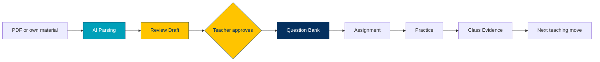

<p align="center">
  
</p>

<h1 align="center">Uniquack</h1>

<p align="center"><b>A learning platform built for the AI era.</b><br>Teachers turn their own materials into reviewed question banks.<br>Students practice, remember and connect, and class work becomes learning evidence.</p>

> [!NOTE]
> **This repository is still being refined and is not the production repository.** [Request access to the production repo](https://uniquack.com/contact).

<p align="center">
  <a href=".github/workflows/ci.yml"></a>
  
  
  
  
</p>

<p align="center">
  <a href="https://uniquack.com/"></a>
  &nbsp;
  <a href="https://uniquack.com/contact"></a>
</p>

<p align="center">
  <a href="#security">Security</a> ·
  <a href="#stack">Stack</a> ·
  <a href="#quick-start">Quick start</a> ·
  <a href="#repository-map">Repository map</a> ·
  <a href="#docs">Docs</a>
</p>

---

Uniquack puts the whole teaching loop in one place: a teacher's own `PDF` or worksheet becomes a reviewed `Question Bank`, the bank feeds `Assignments` and `Practice`, and the results come back as evidence for the next lesson.



| | What you do | What Uniquack gives you |
|---|---|---|
| **Teachers** | Import a PDF, review the draft, approve it | A reusable `Question Bank` with the source still attached |
| | Describe what a question must test | A `Blueprint` that guides new question drafts |
| | Pick questions and assign them | `Assignments` that show students only the selected work |
| | Open the class results | `Class Evidence`: attempts, recurring difficulty, the next teaching move |
| **Students** | Open assigned work | `My Work`, with teacher feedback in one place |
| | Practice on their own | `Independent Practice` and a `Mistake Book` that turns errors into a study list |
| | Collect questions to study | A personal `Study Library` (`Study Rooms` are still concept testing) |

> [!IMPORTANT]
> **AI proposes, people approve.** AI output never publishes itself, and no draft reaches students until a teacher approves it.

Read [AGENTS.md](AGENTS.md) for the rules every change must follow, [CONTEXT.md](CONTEXT.md) for the product model, and [DESIGN.md](DESIGN.md) for the UI.

## Security

Teaching material and student work are sensitive, so these rules are built in, not bolted on.

| Rule | Why it matters |
|---|---|
| **Libraries are private by default.** Public is a deliberate choice, and public does not mean verified. | A teacher's source material is their own work. Using it in class must not publish it. |
| **Students see only the questions assigned to them.** Joining a classroom never opens the teacher's Library. | One class invite cannot expose a whole question collection. |
| **No AI auto-publish.** Every draft needs teacher approval before assignment. | A wrong AI answer cannot reach students unseen. |
| **Formal class evidence and private study stay separate.** | Students can practice and revise freely without it showing up in the gradebook. |
| **Authorization is enforced in the database** with Postgres row-level security, checked again in the app. | A bug in the interface cannot grant access the database refuses. See [authz matrix test design](docs/security/authz-matrix-test-design.md). |
| **AI provider keys stay on the server**, and keys saved in the app are encrypted. | Nothing secret ever reaches the browser. |
| **Migrations only move forward.** Applied migrations are never edited. | The production schema stays reproducible. See [migration release process](docs/security/migration-release-process.md). |

Known findings and their status: [docs/security/findings.md](docs/security/findings.md).

## Stack

| Area | Choice |
|---|---|
| Language | TypeScript (app), Node.js `.mjs` (scripts), SQL (Postgres migrations) |
| Framework | Next.js 16 (App Router, webpack build), React |
| UI | Tailwind CSS 3, Radix UI, shadcn-style components, KaTeX for math |
| Backend | Supabase: Postgres with row-level security, Auth, Storage |
| Validation | zod |
| PDF and images | pdfjs-dist, sharp, @napi-rs/canvas |
| AI | Provider adapters behind a server-side gateway (Gemini and DeepSeek among them), durable job queue with a local worker |
| Tests | Node test runner, `scripts/*-smoke.mjs` smokes, embedded Postgres, Playwright, knip, ESLint |
| Structure | Bank-first: banks hold content, classrooms hold rosters, assignments are deliveries |

## Quick start

<details>
<summary><b>Run it locally</b></summary>

<br>

```bash
npm install
cp .env.example .env.local   # fill in the Supabase URL and keys; never commit it
npm run dev                  # the app
npm run worker:dev           # local AI jobs worker
```

The worker is described in [docs/runbooks/local-ai-jobs-worker.md](docs/runbooks/local-ai-jobs-worker.md). Supabase setup and RLS testing: [docs/supabase-setup-and-rls-testing.md](docs/supabase-setup-and-rls-testing.md).

</details>

<details>
<summary><b>Check your change</b></summary>

<br>

```bash
npm run lint
npm run typecheck
npm run build
node scripts/security-smoke.mjs
node scripts/route-smoke.mjs
npm run smoke
npm run perf:budget
```

Some smokes need a configured Supabase project or an embedded Postgres, and fail without them. Run a script on its own to see which. Many smokes assert `src/` source text and read files under `docs/` by literal path, so search `scripts/` before moving or renaming a file. `npm run deadcode:audit` (knip) cannot see those references, so treat it as a hint only.

</details>

## Repository map

<details>
<summary><b>Where things live</b></summary>

<br>

| Path | What lives there |
|---|---|
| [`src/`](src) | Application code (map below) |
| [`supabase/clean-migrations/`](supabase/clean-migrations) | The canonical migration chain. Always use this, never `supabase/migrations/`. |
| [`scripts/`](scripts) | Smoke tests, gates, evidence runners and operations scripts. [`smoke-all.mjs`](scripts/smoke-all.mjs) is the `npm run smoke` entry. |
| [`test/`](test) | Unit tests (`npm test`, or `npm run test:core` for the core subset) |
| [`fixtures/`](fixtures) | Golden sets and benchmark evidence for AI parsing. Treat as immutable. |
| [`docs/`](docs) | Product docs, runbooks, security evidence; [`docs/archive/`](docs/archive) holds historical reports |
| [`audit/`](audit) | Behavior baseline and refactor-readiness audit |
| [`.github/workflows/ci.yml`](.github/workflows/ci.yml) | CI: lint, typecheck, migration governance, source smokes, embedded-DB smokes |

```text
src/
  app/            Next.js routes
    admin/          platform operations: AI settings, imports, review, questions, tags, users, videos, blueprints
    teacher/        banks, ai-parsing, ai-jobs, blueprints, classrooms, course-builder, progress, publish
    student/        work, classrooms, groups, library, public-library, progress
    practice/       practice sessions
    mistakes/       wrong-question review
    questions/      public question browsing
    videos/         video pages
    auth/           login and auth actions
    api/            route handlers: admin/imports, internal/ai-jobs, practice/*, question-assets, tags, teacher
    i18n/           cookie-based locale switching
    local-test/     local-only test pages
  components/     UI. Feature folders (admin, ai-jobs, ai-pdf-dashboard, blueprints, practice, question-editor,
                  questions, review, student, tags, teacher, ui, i18n) plus shared files in the root
  lib/            Domain and server logic
    auth/           guards, roles, request context
    supabase/       client, server, middleware, config
    ai-providers/   provider adapters, routing, profiles, resilience, JSON repair
    ai-pdf-import/  PDF parsing pipeline: planning, packets, tagging, taxonomy, review drafts (service.ts is the orchestrator)
    ai-jobs/        durable job queue, worker, checkpoint fencing
    ai-operations/  cost catalog and usage accounting
    practice/       practice agent, grading, prompts, persistence
    blueprints/     question blueprint library and review
    batch-import/, bulk-asset-import/, package-import/, import-json/   other import paths
    questions/, tags/, storage/, sanitize/, markdown-latex/, html/, validations/   shared content helpers
    classrooms.ts, teacher-*.ts, student-work.ts, question-banks.ts    bank, classroom and assignment logic
  types/          database.ts (hand-written Supabase types) and shared types
middleware.ts     session refresh and route protection
```

</details>

| If you are working on | Start at |
|---|---|
| A teacher bank, import or review draft | [`src/app/teacher/banks/`](src/app/teacher/banks), [`src/lib/question-banks.ts`](src/lib/question-banks.ts) |
| The AI PDF import pipeline | [`service.ts`](src/lib/ai-pdf-import/service.ts), [`worker.ts`](src/lib/ai-jobs/worker.ts), [`local-ai-jobs-worker.mjs`](scripts/local-ai-jobs-worker.mjs) |
| Assigning from a bank | [`teacher-assignments.ts`](src/lib/teacher-assignments.ts), [`src/app/teacher/classrooms/`](src/app/teacher/classrooms) |
| Student practice and evidence | [`src/lib/practice/`](src/lib/practice), [`src/app/api/practice/`](src/app/api/practice), [`src/app/student/work/`](src/app/student/work) |
| Authorization | [`src/lib/auth/`](src/lib/auth), [`docs/security/`](docs/security) |
| A database change | Add a new forward-only file in [`supabase/clean-migrations/`](supabase/clean-migrations), after reading [the release process](docs/security/migration-release-process.md) |

## Docs

Start at the [docs index](docs/README.md). The behavior baseline is in [audit/README.md](audit/README.md), and older reports are in [docs/archive/](docs/archive/README.md).

Questions or access requests: [uniquack.com/contact](https://uniquack.com/contact).
