# Dual-Vertex 50-PDF Capacity Plan

Status: implementation plan only

Source baseline: `origin/main` at `d5a29ea`

Audit date: 2026-07-19

## 1. Decision summary

EduStruct should accept a burst of up to 50 private PDFs without tying processing to the upload request. Each PDF becomes one durable, independently retryable job. Two symmetric Vertex AI execution targets run active-active behind a capacity-aware router. The existing Supabase job record remains the authoritative lifecycle record; a Vercel Queue or Workflow may wake workers, but must never become a second source of truth.

The first launch setting is deliberately conservative:

- primary extraction: two concurrent jobs per Vertex project, four total;
- quality escalation: one concurrent job per project, two total;
- OCR fallback: one concurrent job per OCR model deployment until measured;
- embeddings: asynchronous, lower priority, and outside draft-readiness latency;
- no AI output bypasses Review Drafts or auto-publishes.

These are application admission limits, not claims about Google quota. Promotion requires measured quota and latency in both projects.

## 2. Scope and non-goals

This plan covers burst admission, private upload, durable processing, project/model routing, Vercel deployment, identity, observability, testing, rollout, and rollback. It does not implement a migration, provider adapter, queue, worker, credential, model call, or deployment.

The protected product path remains:

```text
Private PDF -> AI Parsing -> Review Drafts -> Question Bank -> Assignment -> Practice Evidence
```

## 3. Current pipeline findings

| Area | Current behavior | Capacity consequence |
|---|---|---|
| Durable jobs | `ai_provider_jobs` has atomic claim, lease, heartbeat, retry, fairness, and idempotency | Strong base; current admission limits block a 50-file burst |
| Worker | Internal route runs at most two jobs and has `maxDuration = 240` | A full provider round trip can consume one function invocation |
| PDF job | Worker downloads the complete private PDF into a Node buffer | Four 50 MB jobs can create material memory pressure |
| Admin upload | Browser uses a signed upload URL for private `ai-import-sources` | Correct direct-to-storage pattern |
| Teacher Bank upload | Server Action calls `File.arrayBuffer()` before Storage upload | Must converge on signed direct upload before burst launch |
| Provider routing | Ordered profiles, retry budget, fallback, and per-operation circuit state exist | No Vertex project identity or per-project/model capacity lease exists |
| Gemini adapter | Uses the Gemini Developer API, API key, and Files API | It is not a Vertex OIDC adapter |
| Persistence | AI PDF imports create Review Drafts and support partial results | Preserve; add stage-level idempotency and fencing |
| Operations | Queue, latency, failure, cost, circuit, fallback, and budget telemetry exist | Extend with target project, model role, stage, and burst metrics |
| Vercel | No `vercel.json`; internal worker route is token-triggered | Deployment and async transport remain undefined |
| Storage schema | Runtime expects private `ai-import-sources` | Canonical clean migrations do not currently create this bucket |

Source anchors: `src/lib/ai-jobs/queue.ts`, `src/lib/ai-jobs/worker.ts`, `src/lib/ai-jobs/policy.ts`, `src/app/api/internal/ai-jobs/run/route.ts`, `src/lib/ai-providers/routing.ts`, `src/lib/ai-providers/gemini-native.ts`, `src/components/ai-pdf-import-panel.tsx`, `src/app/teacher/banks/actions.ts`, and clean migrations `0033` through `0038`.

The current closed-beta scheduler limits are global active 3, PDF active 1, per-organization active 1, outstanding per user 5, and outstanding per organization 12. Jobs receive up to four executions, with a 900-second lease and a 60-second worker heartbeat. The worker clamps each invocation to at most two claimed jobs and executes those two concurrently. These are safety controls to replace with measured, target-aware admission limits, not values to scale by editing constants alone.

## 4. Target architecture

```mermaid
flowchart LR
    U["Teacher browser"] --> R["Burst reservation: up to 50 items"]
    R --> S["Private Storage direct upload"]
    S --> F["Finalize metadata and validate source"]
    F --> J["Authoritative ai_provider_jobs record"]
    J --> Q["Work-signal transport"]
    Q --> W["Vercel worker / durable step"]
    W --> C["Atomic project-model capacity lease"]
    C --> A["Vertex project A"]
    C --> B["Vertex project B"]
    A --> P["Idempotent draft persistence"]
    B --> P
    P --> D["Review Drafts"]
    P --> E["Low-priority embeddings"]
```



### One source of truth

`ai_provider_jobs` owns status, attempt count, retry schedule, lease, stage, selected execution target, and final bounded result. A queue message contains only a versioned job ID and wake-up reason. At-least-once message delivery must be harmless: the database claim and output idempotency decide whether work may proceed.

### Queue/Workflow abstraction

Define two narrow future interfaces:

```text
DurableJobStore
  enqueue, claimById, heartbeat, checkpoint, finish, cancel

WorkSignalTransport
  publish(jobId, notBefore, idempotencyKey)
```

The first transport can remain a database poll/cron wake-up. A later Vercel Queues adapter can deliver job IDs. Use Vercel Workflow only if durable multi-step suspension materially reduces custom checkpoint code. Do not replace the database lifecycle with a second Vercel-only lifecycle.

## 5. Burst and job lifecycle

### Burst lifecycle

```text
reserving -> uploading -> ready -> queued -> processing
-> completed | partial | failed | cancelled
```

The parent burst is an aggregate view. Its state is derived from item states and never hides per-PDF failures.

### PDF item lifecycle

```text
reserved -> uploaded -> validated -> queued -> leased
-> extracting -> validating -> persisting -> draft_ready
-> embedding_pending -> completed
```

Any execution stage may enter `retry_wait`, `failed`, or `cancelled`. `partial` means at least one valid Review Draft was persisted and at least one expected extraction unit failed or remains unresolved.

### Admission

1. Reserve no more than 50 items with a client-generated idempotency token.
2. Return signed private upload grants; never proxy PDF bytes through a Vercel function.
3. Finalize each upload independently and verify size, type, page count, object ownership, and immutable source reference.
4. Create one PDF job per ready item, but release work only within configured organization and global windows.
5. Show queued/processing/partial/failed counts without exposing provider internals.

The current five-per-user and twelve-per-organization outstanding limits must not simply be raised without an admission design. Prefer a 50-item burst manifest plus a bounded ready window so one organization cannot consume all active capacity.

## 6. Active-active project routing

Both Vertex projects must have equivalent model allowlists, regions, quotas, IAM policy, safety settings, and observability. They are separate execution targets, not primary/backup labels.

For every execution attempt:

1. Build candidates compatible with the operation and model role.
2. Exclude disabled, lifecycle-blocked, circuit-open, cooldown, and capacity-full targets.
3. Rank by normalized active load, recent 429 rate, rolling latency, and deterministic tie-break hash of job ID.
4. Atomically acquire a `(project, region, model, operation)` capacity lease.
5. Bind that attempt to the target; heartbeat both job and capacity lease.
6. Release capacity after a fenced completion/checkpoint.

Do not route solely with `jobId % 2`: it ignores cooldown and quota imbalance. Do not permanently pin a job to a project before execution; retryable availability failures should be able to use the peer project.

Detailed model and concurrency policy: [vertex-model-routing-matrix.md](vertex-model-routing-matrix.md).

## 7. Retry, 429, cooldown, and heartbeat

- Keep short request retries only for transient network failures and bounded 5xx responses.
- On 429, record the project/model/operation failure, respect a bounded `Retry-After`, add full jitter, and set a durable cooldown.
- Recommended cooldown bounds: minimum 5 seconds, maximum 15 minutes. Exact values are launch configuration, not constants in model code.
- The alternate project may run the next attempt only if it has capacity and its own circuit is healthy.
- Do not fail over authentication, permission, invalid-request, unsupported-model, schema-contract, or content-policy errors.
- Default job lease: greater than the provider timeout plus persistence margin; heartbeat every 30-60 seconds.
- Every write and completion uses a lease fencing token so an expired worker cannot commit after recovery.
- A job has a finite execution-attempt budget. Poison jobs end in a reviewable failed state rather than retrying forever.

## 8. Idempotent persistence

Required keys:

- upload reservation: `(burst_id, client_item_key)`;
- source object: immutable object path plus verified byte count and optional SHA-256;
- logical extraction: `(source_asset_id, parser_contract_version)`;
- execution: `(job_id, attempt, stage_version)`;
- extracted item: stable source identity using source pages, extracted order, and content fingerprint, never visible question number alone;
- embedding: `(question_id, normalized_content_hash, embedding_model_version)`.

Persist normalized questions in a transaction or checkpointed page/chunk group. Replaying the same result must upsert the same drafts, not append duplicates. Database `question_code` remains server-generated, and visible numbering remains review metadata. Completion is recorded only after all expected writes are committed. No stage may publish or assign a draft.

## 9. Model stages

1. Primary extraction with `gemini-3.1-flash-lite` after exact target availability is verified.
2. Deterministic schema validation and repair.
3. Quality escalation to `gemini-3.5-flash` only for allowlisted signals and within budget.
4. OCR fallback only for detected low-text/image-heavy pages, through a separate adapter.
5. Embeddings after successful extraction/normalization; this stage is low priority and must not block Review Drafts.

See [vertex-model-routing-matrix.md](vertex-model-routing-matrix.md) for important product/API availability gates.

## 10. Future schema changes

No migration is created by this planning PR. A later forward-only canonical clean migration is expected to add or extend:

- a burst parent and burst items linked to existing import batches/assets/jobs;
- execution-target configuration for project alias, location, auth mode, model role, and environment;
- project/model capacity leases and durable cooldown state;
- job stage/checkpoint, target/model selection, fencing token, and burst linkage;
- model lifecycle metadata: release channel, benchmark-only flag, retirement date, disable date, and replacement;
- idempotent output lineage and embedding version records;
- private `ai-import-sources` bucket/policies in the canonical clean chain if still absent.

Do not apply files from legacy `supabase/migrations`. All database/storage changes require a separate migration review, RLS tests, and rollback-by-forward-change plan.

## 11. Future runtime changes

- Converge Teacher Bank PDF upload on the signed direct-upload path.
- Add a Vertex OIDC adapter; do not retrofit API-key Gemini Files API behavior as if it were Vertex.
- Add target-aware capacity acquisition before provider execution.
- Split worker execution into checkpointed stages with bounded memory and time.
- Stream or spool source content where the selected API permits; avoid unbounded multi-PDF buffering.
- Add burst aggregation and UI progress without exposing provider project names to ordinary users.
- Extend safe telemetry with target alias, model role/version, stage, cooldown reason, and redacted provider request correlation.
- Preserve existing Review Draft, Bank ownership, and no-auto-publish gates.

## 12. Metrics and alerts

Measure by environment, operation, project alias, model role, and stage:

- burst accepted/ready/queued/active/completed/partial/failed;
- queue depth, oldest age, admission wait, lease recovery count;
- active capacity versus configured limit;
- provider latency p50/p95/p99, success, 429, 5xx, timeout, fallback, escalation;
- cooldown and circuit duration;
- duplicate message received, duplicate output prevented, stale writer rejected;
- drafts per PDF, zero-draft rate, validation warning rate;
- tokens, images/pages, estimated cost, and budget reservation variance;
- embedding backlog and age.

Initial alerts: oldest ready item over SLO, project disabled/circuit open, 429 spike, lease expiry spike, zero-draft spike, duplicate prevention failure, both projects unavailable, budget threshold, storage-finalize failure, and Review Draft persistence failure.

## 13. Rollout and rollback

1. Add local deterministic routing/capacity tests with two fake targets.
2. Add canonical schema and RLS in a separate PR; keep new execution disabled.
3. Add Vertex OIDC adapter and preview identities; test only after explicit cloud approval.
4. Enable one preview project at concurrency one, then both projects at one each.
5. Pass 10-, 25-, and 50-PDF gates before increasing to two per project.
6. Enable quality escalation, OCR, and embeddings independently behind operation flags.
7. Production canary by organization, then gradual percentage rollout.

Rollback is operational: pause admission or claims, disable one target/model/stage, drain or retain queued jobs, and route new attempts to the last known-good target. Never roll back an applied migration. Source PDFs and Review Drafts remain private and recoverable.

## 14. Unresolved decisions

- Whether preview uses two separate Google projects or environment-bound service accounts inside the production pair. Separate projects are safer.
- Which Vercel plan/runtime and region will host workers, and its verified duration/memory/concurrency limits at implementation time.
- Vercel Queues versus Workflow after a small non-provider prototype; Queues is currently beta.
- Exact Vertex regions and quotas for every target model.
- Whether `gemini-embedding-2` is a future/private identifier; current public Vertex documentation confirms `gemini-embedding-001`, not that requested ID.
- Whether Mistral OCR and DeepSeek OCR can meet the same residency, commercial, and API constraints as Gemini.
- Representative production PDF size/page distributions and launch drain-time SLO.

## 15. Acceptance for implementation PRs

Each future PR must state goal, non-goals, Bank ownership, role boundaries, storage/data ownership, Review Draft gate, migration risk, tests, and rollback. No production enablement occurs until [pdf-50-load-test-plan.md](pdf-50-load-test-plan.md) passes and [vercel-pdf-worker-deployment.md](vercel-pdf-worker-deployment.md) is reviewed.
